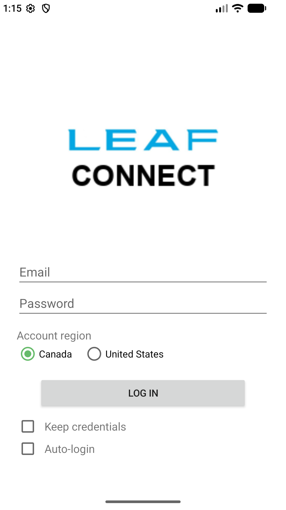
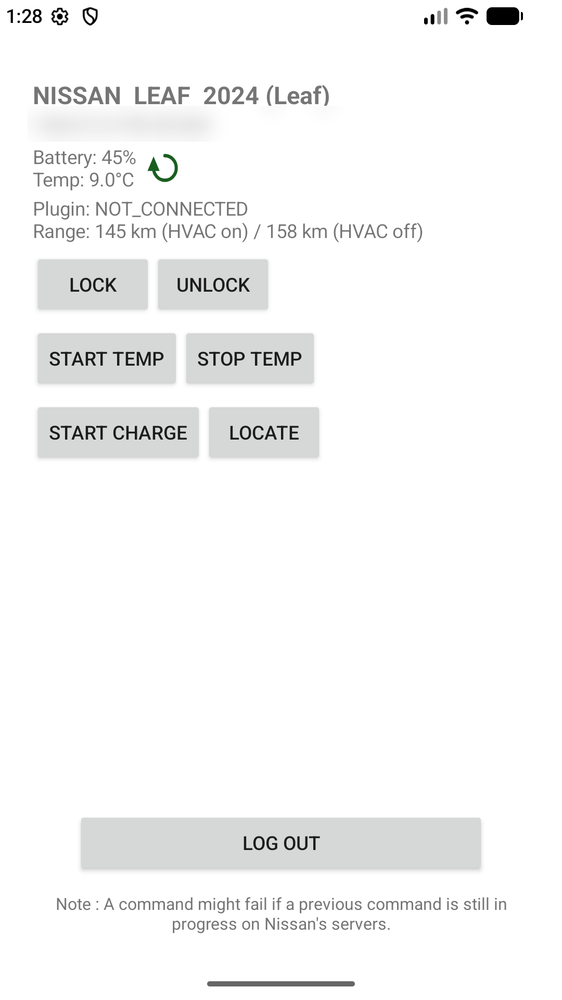

# LeafConnect

Kotlin Multiplatform client for the Nissan Connect (Janus) remote API for
Nissan LEAF vehicles: battery/charge status, cabin temperature, remote climate
start/stop, remote charging start, door lock/unlock and vehicle locating. One
codebase, two platforms: Android and iOS share the HTTP client, session logic
and Compose UI.

The app talks to the same endpoints the official Android app uses. It is not
affiliated with Nissan; the API is undocumented, the constants below are taken
from the official client, and the backend can change at any time.

## Features

* Login, auto-login, "keep credentials" (stores email and password — see
  [Privacy](docs/PRIVACY.md)).
* Battery %, cabin temperature, plug state, estimated range (HVAC on / off),
  per vehicle, refreshed by pull-to-refresh and by periodic watchdogs.
* Units follow the account region: Canada shows km and °C; United States shows
  miles and °F (the payload is km/Celsius, so values are converted, not
  relabeled).
* Remote commands: START TEMP, STOP TEMP, START CHARGE, LOCATE (opens the
  platform map app), LOCK, UNLOCK — the door endpoints send a default all-zero
  PIN.
* Vehicle name built from the VIN (offline decoder in `VinDecoder.kt`), plus
  the account nickname.
* Session self-healing: a 401 re-authenticates once and retries; a session
  that cannot be healed ends on the login screen.

## Screenshots

<table>
  <tr>
    <td></td>
    <td></td>
  </tr>
</table>

## Modules

| Module     | Role                                                                |
|------------|---------------------------------------------------------------------|
| `shared`   | Kotlin Multiplatform library: client, session, Compose UI, resources |
| `app`      | Android application: `MainActivity` hosts the shared Compose UI      |

The iOS side is declared in `shared` (`iosArm64`, `iosSimulatorArm64` static
framework `LeafConnectFramework`, entry point `MainViewController()`); the
iOS host app links the framework and sets
`window.rootViewController = MainViewController()`.

## Build

Android builds on any host. Requirements: Android SDK (compile SDK 37), a JDK —
`gradle-daemon-jvm.properties` pins the toolchain (no JDK path is hardcoded in
`gradle.properties`; the Gradle toolchain provisions what is missing).

```sh
./gradlew :app:assembleDebug            # debug APK, signed with the local debug key
./gradlew :app:assembleRelease          # release APK, minified; signed only when
                                        # keystore.properties exists
./gradlew packageLeafConnect            # copies the release APK to app/build/outputs/apk/release/LeafConnect.apk
```

iOS targets compile **only on macOS** (Kotlin/Native needs Xcode); on Windows
and Linux those tasks are disabled and skipped:

```sh
./gradlew :shared:linkDebugFrameworkIosSimulatorArm64   # simulator framework (macOS)
./gradlew :shared:linkDebugFrameworkIosArm64            # device framework (macOS)
```

Output: `app/build/outputs/apk/debug/app-debug.apk` and
`app/build/outputs/apk/release/LeafConnect.apk`; on macOS, the framework under
`shared/build/.../bin/iosSimulatorArm64/`.

### Signing a release

Signing material is **not** in this repository. Create a keystore on your
machine and describe it in `keystore.properties` at the repository root
(gitignored, never committed):

```properties
storeFile=leafconnect.keystore
storePassword=<your keystore password>
keyAlias=<your key alias>
keyPassword=<your key password>
```

`storeFile` is resolved relative to the repository root. Without the file,
`assembleRelease` produces an **unsigned** release APK instead of failing with
empty passwords; sign it yourself (`apksigner`) or add the file.

## Tests, lint, CI

```sh
./gradlew :shared:testAndroidHostTest   # shared unit tests (AppLocale, CookieStore, VinDecoder)
./gradlew :app:lintDebug                # lint gate; suppressions and reasons in app/lint.xml
```

`.github/workflows/ci.yml` runs the same gates (unit tests, lint) and then
`packageLeafConnect` on every push and pull request. Each push to `main`
re-publishes the single GitHub release `release-latest`: the release is
retargeted to that commit and its asset replaced (deleting a release or tag
created by the Actions token is refused, so nothing is deleted), which keeps
only the newest release; the sha stays in the title. Releases from the older
`release-<short sha>` scheme are swept away by the same job. Each pull request
gets a prerelease (`pr-<number>`) updated the same way on every new
push to the PR. It signs when the repository defines the secrets
`LEAF_KEYSTORE_BASE64`, `LEAF_STORE_PASSWORD` and `LEAF_KEY_PASSWORD`;
without them the published APK is unsigned.

## Architecture

Shared code (`shared/src/commonMain`):

| File                      | Role                                                                            |
|---------------------------|---------------------------------------------------------------------------------|
| `App.kt`                  | Compose UI shell: screens, messages, splash                                     |
| `LoginScreen.kt`          | login form, credential preferences, region selector                             |
| `HomeScreen.kt`           | vehicle cards, status, remote commands, logout, pull-to-refresh                 |
| `AppController.kt`        | screens' state as flows; rounds run as coroutines with cancellation tokens      |
| `NissanConnectSession.kt` | session state, login, re-authentication, 401 routing                            |
| `NissanConnectClient.kt`  | one vehicle's endpoints; the single 401 self-heal path                          |
| `NissanConnectAuth.kt`    | Ktor HTTP transport, headers, constants, cookie handling                        |
| `CookieStore.kt`          | full session cookie set, merged per domain+path+name, encrypted persistence     |
| `SettingsStore.kt`        | encrypted key/value store; platform-backed (`expect`/`actual`)                  |
| `CredentialStore.kt`      | credentials in RAM; encrypted store is the fallback when Keep credentials is on |
| `CancellationToken.kt`    | real cancellation of in-flight requests (coroutine Jobs)                        |
| `AppLocale.kt`            | region/language codes, km↔mi and °C↔°F rules                                     |
| `VinDecoder.kt`           | VIN → maker/model/year (offline)                                                |
| `NissanConnectCache.kt`   | last battery payload per VIN, keyed by login generation                         |
| `StatusFormatting.kt`     | payload numbers + region unit conversion                                        |

Platform seams (`expect`/`actual`): the settings store (Android: DataStore +
Tink AES-GCM with a Keystore key; iOS: a JSON file in `Library/`, encrypted at
rest by iOS Data Protection), the HTTP engine (OkHttp / NSURLSession), the
device locale, and the maps opener. `shared/src/androidMain` and
`shared/src/iosMain` contain only these seams plus the platform entry points.

Design rules the code follows:

* Requests run as coroutines inside a mutex: rounds are serialized like the old
  single worker thread, so concurrent 401s cannot race the shared token/cookie
  state. Cancellation is a coroutine Job — it aborts the request on both
  engines, which `Thread.interrupt()` never did.
* Connection failures are retried by the engines themselves (OkHttp
  `retryOnConnectionFailure`, NSURLSession default), not by hand: a hand-rolled
  retry could send a remote command twice.
* Shared mutable state is confined: per-request 401 suppression, a plain
  soft-login counter under the mutex, one guarded logout path (`logout` with
  `logoutStarted`).

## API notes

See [docs/API.md](docs/API.md) for the endpoints, headers and request bodies,
and [docs/PRIVACY.md](docs/PRIVACY.md) for exactly what is stored on the
device.

## Known limitations

* `API-Key` / `User-Agent-Key` are constants baked into the official client;
  they cannot be hidden on a device that ships the app, so they are
  documented in code and in `docs/API.md`.
* Soft-login and re-authentication need the password: RAM first, then the
  encrypted store (Keep credentials). Only when neither is available after a
  process restart does the app keep using the stored token, and a 401 it
  cannot heal logs out to the login screen.
* Nissan's servers rate-limit remote commands; a command may be rejected while
  a previous one is still running (the UI shows that note).
* iOS compilation needs macOS with Xcode; the targets are declared here and
  built there, so a Windows checkout only builds and tests Android.
